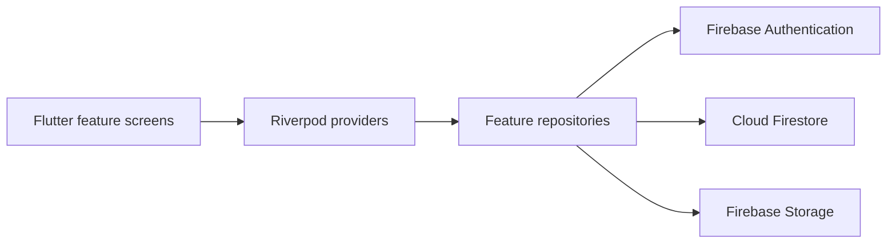

# Campus Lost & Found

**A Flutter/Firebase application for reporting found items, reviewing ownership claims and coordinating campus handovers.**

This academic application has evolved from an in-memory demo into a Firebase-backed implementation. The current entry point initialises Firebase; authentication, item/claim repositories, photos and chat use Firebase services. It should be treated as a development application until backend rules, permissions and deployment are verified.

## Implemented flows

- Email/password sign-in and registration through Firebase Authentication.
- Found-item registration, categorisation, browsing and filtering.
- Claim submission and officer review/handover screens.
- Firestore-backed user, item, claim and chat repositories.
- Item photo handling using Firebase Storage and Firestore metadata.
- QR presentation and audit-log repository support.

Role-dependent screens are implemented in the client. Client-side role checks are not a substitute for Firestore and Storage security rules.

## Architecture



`go_router` handles navigation. Freezed and JSON serialization generate model helpers. Repositories expose streams to Riverpod providers so the UI reacts to changes.

| Path | Purpose |
| --- | --- |
| `lib/main.dart` | Firebase startup and application entry point |
| `lib/app/` | Routing, theme and application shell |
| `lib/core/` | Shared models, repositories, utilities and widgets |
| `lib/features/` | Authentication, found items, claims, reporting and chat |
| `lib/providers/` | Repository wiring and reactive state |
| `test/` | Existing widget/repository/utility tests |

## Development setup

Install a Flutter SDK compatible with `pubspec.lock` and a supported platform toolchain. Use a separate Firebase development project.

1. Enable Email/Password authentication, Cloud Firestore and Storage in that project.
2. Configure the target platforms with FlutterFire (`flutterfire configure`). Generate your own `lib/firebase_options.dart` and platform configuration files; do not reuse another developer's backend.
3. Review and deploy least-privilege Firestore/Storage rules in your own Firebase project before using real accounts or photos. These backend rules are not versioned in this repository.
4. Install dependencies and generate models:

```bash
flutter pub get
dart run build_runner build --delete-conflicting-outputs
flutter run
```

Firebase client configuration identifies an application; a service-account private key must never be shipped in a client or committed to this repository. Keep real student details, messages and images out of test data.

## Checks

```bash
flutter analyze
flutter test
```

The existing suite includes tests inherited from the earlier demo. Firebase integration and backend authorization still need dedicated test coverage; do not interpret these commands as evidence that every current cloud flow is verified.

## Current limits and next work

- Firebase configuration is environment-specific and the repository does not provide a reproducible backend-rules setup.
- Generated iOS build output was committed under `assets/build/`; it is not source material and should be removed through a reviewed cleanup change.
- The old demo comments and some tests need reconciliation with the Firebase implementation.
- Backend rule tests, error-path coverage, claim authorization and a documented handover walkthrough are the next priorities.

This README describes the implemented code paths without claiming a production deployment. Contributor ownership for team work should be recorded before using this project as evidence of individual delivery.
